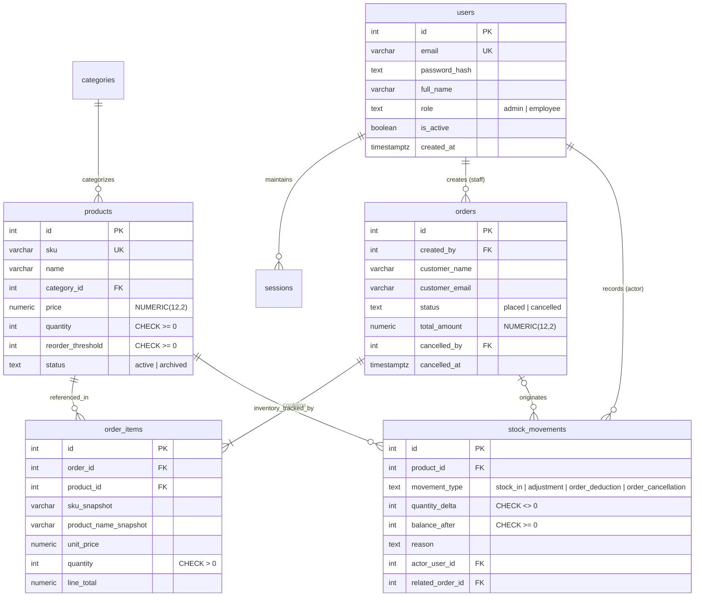

# StockPilot — Full-Stack Inventory & Order Management System

StockPilot is an enterprise-grade, transaction-safe Inventory and Order Management System designed for small-to-medium businesses. Built with a normalized PostgreSQL relational database, an Express.js layered backend, and a modern React 19 + Tailwind CSS single-page interface, StockPilot solves realistic warehousing problems including multi-item atomic order processing, pessimistic row-level locking for concurrency control, comprehensive stock movement audit trails, and role-based access management.

---

## 🌟 Key Engineering Features & Highlights

- **ACID Transaction-Safe Order Placement**: Multi-item orders execute inside isolated PostgreSQL transactions. Either all order items, inventory decrements, and stock movements commit together, or the entire operation cleanly rolls back.
- **Pessimistic Concurrency Control (`FOR UPDATE`)**: Prevents race conditions and inventory overselling when simultaneous concurrent requests compete for limited stock.
- **Deadlock-Free Lock Acquisition**: Products are deterministically sorted by `id ASC` before row-level locks are acquired, mathematically preventing cyclic wait deadlocks.
- **Immutable Stock Movement Audit Trail**: Every physical stock change (`stock_in`, `order_deduction`, `adjustment`, `order_cancellation`) is permanently recorded with user identity, before/after balances, and mandatory audit reasons.
- **Snapshot Pricing & Data Integrity**: Order items store frozen snapshots of SKU, product title, and unit price at time of purchase, preventing historical financial tampering if product records change later.
- **Money Precision**: Calculations avoid JavaScript floating-point errors by using integer cents and PostgreSQL `NUMERIC(12,2)`.
- **Role-Based Access Control (RBAC)**: Backend-enforced authorization separating **Admin** (catalog management, manual stock adjustments, user administration, executive dashboards) from **Employee** (catalog search, order creation).
- **Automated Vitest Test Suite**: 19 automated integration tests covering concurrent race conditions, stock rollbacks, insufficient inventory rejection, authentication flows, and RBAC guards.

---

## 🏗 System Architecture

StockPilot adopts a strict, decoupled layered architecture:

```
[ React 19 SPA ]
       │
       ▼  HTTP / REST (JSON)
[ Express 5 Route Layer ]  ──> Validation Middleware (Zod) & Auth Guards (Bearer / Cookie)
       │
       ▼
[ Controller Layer ]       ──> HTTP serialization & status code mapping
       │
       ▼
[ Service Layer ]          ──> Core business logic, transaction boundaries (BEGIN/COMMIT/ROLLBACK)
       │
       ▼
[ Repository Layer ]       ──> Explicit parameterized SQL queries via `pg` (node-postgres)
       │
       ▼
[ PostgreSQL 17 Engine ]   ──> Tables, Foreign Keys, Unique Indexes, Check Constraints, Row Locks
```

---

## 🗄 Database Schema & Entity Relationship Diagram



---

## 📡 REST API Reference

### Authentication (`/api/auth`)
| Method | Endpoint | Access | Description |
|---|---|---|---|
| `POST` | `/api/auth/login` | Public | Authenticates credentials, creates session token |
| `GET` | `/api/auth/me` | Authenticated | Retrieves current authenticated user profile |
| `POST` | `/api/auth/logout` | Authenticated | Revokes session and clears auth cookies |

### Products (`/api/products`)
| Method | Endpoint | Access | Description |
|---|---|---|---|
| `GET` | `/api/products` | Authenticated | List products with search, category & low-stock filters |
| `GET` | `/api/products/:id` | Authenticated | Get product specs & recent stock movement log |
| `POST` | `/api/products` | Admin Only | Create new SKU with initial stock intake movement |
| `PUT` | `/api/products/:id` | Admin Only | Update product details |
| `DELETE` | `/api/products/:id` | Admin Only | Soft-archive product (preserves order history) |
| `POST` | `/api/products/:id/adjust-stock` | Admin Only | Transactional stock adjustment / manual restock |

### Orders (`/api/orders`)
| Method | Endpoint | Access | Description |
|---|---|---|---|
| `GET` | `/api/orders` | Authenticated | List customer orders with pagination & status filters |
| `GET` | `/api/orders/:id` | Authenticated | Full order breakdown with snapshot item history |
| `POST` | `/api/orders` | Authenticated | Atomically place order, lock stock, deduct inventory |
| `POST` | `/api/orders/:id/cancel` | Admin Only | Cancel order, restock items & record cancellations |

### Audit & Reports
| Method | Endpoint | Access | Description |
|---|---|---|---|
| `GET` | `/api/stock-movements` | Admin Only | Full audit log of all warehouse movements |
| `GET` | `/api/dashboard` | Admin Only | Executive KPIs, low-stock warnings & chart trends |
| `GET` | `/api/users` | Admin Only | List staff accounts |
| `POST` | `/api/users` | Admin Only | Register new employee or admin account |
| `PATCH` | `/api/users/:id/status`| Admin Only | Activate / deactivate staff account |

---


