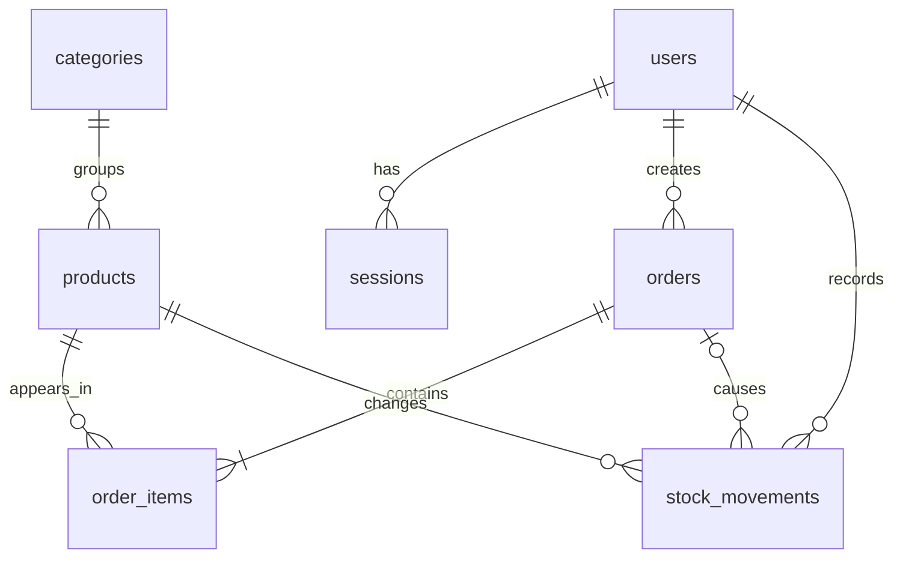

# Initial PostgreSQL schema

The migration at `server/db/migrations/0001_initial.sql` creates the six business tables from Phase 1, plus `sessions` for revocable authentication and `schema_migrations` to track applied migrations.

- Each table has a primary key. Foreign keys preserve relationships with users, categories, products, and orders.
- Product quantity is the current balance; stock movements explain every change. Future stock-writing services must update both in one transaction.
- Prices and totals use `NUMERIC(12,2)` so database arithmetic is exact. The server must not use JavaScript floating-point arithmetic for authoritative totals.
- Order items retain SKU, name, and unit-price snapshots so edits to a product cannot rewrite order history.
- Stock and reorder threshold are nonnegative integers. An order item must have a positive quantity. A movement must have a nonzero signed change and a nonnegative resulting balance.
- Product SKU, user email, and category name have case-insensitive unique indexes. List and history indexes support their expected filters.
- Business records are retained: products are archived, users are deactivated, and orders are cancelled rather than deleted.
